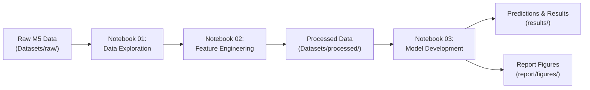

# Inventory Demand Forecasting — Walmart M5 Retail Analysis

[](https://www.python.org/)
[](https://scikit-learn.org/)
[](https://jupyter.org/)
[]()

> **Applied Machine Learning (AML) Team Project — Phase 1**  
> Empirical comparison of heuristic, state-space, and gradient-boosted machine learning models for intermittent retail demand forecasting on the Walmart M5 dataset.

---

## Table of Contents
- [Project Overview](#project-overview)
- [Repository Architecture](#repository-architecture)
- [Dataset & Preparation](#dataset--preparation)
- [Forecasting Methodology & Pipeline](#forecasting-methodology--pipeline)
- [Models Evaluated](#models-evaluated)
- [Experimental Results](#experimental-results)
  - [Overall Model Comparison](#overall-model-comparison)
  - [Window-by-Window Performance](#window-by-window-performance)
  - [Key Findings & Trade-offs](#key-findings--trade-offs)
- [Visualizations](#visualizations)
- [Setup & Installation](#setup--installation)
- [How to Run](#how-to-run)
- [Deliverables & Reports](#deliverables--reports)
- [Future Work & Phase 2 Roadmap](#future-work--phase-2-roadmap)

---

## Project Overview

In retail supply chains, stockouts lead to lost revenue while overstocking incurs heavy holding costs and spoilage. Accurate unit-level demand forecasting is notoriously difficult because store-item (SKU) level sales are frequently **intermittent, zero-inflated, and subject to weekly seasonality, promotional spikes, and policy events (e.g., SNAP distribution days)**.

This project implements an end-to-end forecasting pipeline using the **Walmart M5 Forecasting dataset**:
1. **Explores intermittent demand patterns** across stores, dates, and event schedules.
2. **Builds a leak-free feature engineering pipeline** with lag, rolling-window statistics, calendar attributes, and SNAP indicators.
3. **Conducts a rigorous benchmark across 4 rolling 7-day forecast windows** (28 days total holdout) comparing:
   - **Seasonal Naive Baseline** (7-day periodic persistence)
   - **Local-Level Kalman Filter** (Univariate state-space model with 80% Gaussian uncertainty intervals)
   - **Global Gradient Boosting Regressor** (`HistGradientBoostingRegressor` with recursive multi-step autoregression)

---

## Repository Architecture

```plaintext
Inventory-demand-forecasting/
├── .gitignore                                      # Ignored build, OS, venv, and large data files
├── requirements.txt                                # Project dependencies
├── README.md                                       # Comprehensive project documentation
├── Datasets/
│   ├── raw/                                        # Raw M5 dataset files (.gitkeep tracked)
│   │   ├── calendar.csv                            # Dates, event markers, and SNAP indicators
│   │   ├── sales_train_validation.csv              # Daily unit sales per store-item series
│   │   └── sell_prices.csv                         # Weekly selling prices per store-item
│   └── processed/                                  # Prepared model data and configs (.gitkeep tracked)
│       ├── phase1_config.json                      # Serialization of experiment settings
│       ├── phase1_forecast_windows.csv             # 4 rolling 7-day evaluation windows
│       ├── phase1_prepared.pkl                     # Reshaped feature table (wide-to-long)
│       └── phase1_selected_series.csv              # 100 sampled series identifiers
├── Notebooks/
│   ├── 01_data_exploration.ipynb                   # Exploratory data analysis & seasonality
│   ├── 02_feature_engineering.ipynb                # Feature extraction & rolling window setup
│   └── 03_model_development.ipynb                  # Model training, evaluation & diagnostics
├── Presentation/
│   └── Inventory_Demand_Forecast_AML_Team_Project_Phase_1 (1).pdf # Team presentation slide deck
├── report/
│   ├── Inventory_Demand_Forecasting_Team_Report.pdf # Full written team technical report
│   └── figures/                                    # Generated publication-quality plots
│       ├── aggregate_time_patterns.png             # Daily, weekly, and monthly aggregate demand
│       ├── demand_distribution.png                 # Histogram of SKU-level demand (intermittency)
│       ├── mae_by_window.png                       # MAE trajectory across 4 test windows
│       └── weekday_average_sales.png               # Day-of-week sales variations
└── results/
    ├── phase1_model_comparison.csv                 # Aggregate MAE, RMSE, WAPE & coverage metrics
    ├── phase1_predictions.csv.gz                   # Out-of-sample predictions across all series
    └── phase1_window_results.csv                   # Per-window breakdown of performance
```

---

## Dataset & Preparation

The raw data is derived from the **Kaggle M5 Forecasting — Accuracy Competition**:
- **Daily Unit Sales (`sales_train_validation.csv`)**: Unit sales for 30,490 product-store series across 10 stores located in 3 US states (California, Texas, Wisconsin) over 1,913 days (`d_1` to `d_1913`).
- **Calendar Data (`calendar.csv`)**: Dates, weekdays, months, cultural/sporting event names, and state-specific SNAP distribution days (`snap_CA`, `snap_TX`, `snap_WI`).
- **Pricing Data (`sell_prices.csv`)**: Historical weekly selling prices per store-item.

### Experimental Design (Phase 1 Sample)
To ensure reproducible, rapid, and fair model iterations:
- **Sample Size**: 100 representative product-store series (stratified: exactly 10 series randomly sampled with `random_state=42` from each of the 10 Walmart stores).
- **Forecast Horizon**: 7 days per window ($H = 7$).
- **Evaluation Windows**: 4 consecutive rolling test windows spanning the final 28 days of history:
  - **Window 1**: Days 1886–1892 (Origin: `d_1885` / 2016-04-24)
  - **Window 2**: Days 1893–1899 (Origin: `d_1892` / 2016-05-01)
  - **Window 3**: Days 1900–1906 (Origin: `d_1899` / 2016-05-08)
  - **Window 4**: Days 1907–1913 (Origin: `d_1906` / 2016-05-15)
- **Total Forecast Evaluations**: $100 \text{ series} \times 7 \text{ days} \times 4 \text{ windows} = 2,800$ point predictions per model.

---

## Forecasting Methodology & Pipeline

The pipeline is split cleanly across three interactive notebooks in [Notebooks/](file:///Users/jatin./Desktop/Inventory-demand-forecasting/Notebooks):



### 1. Data Exploration (`01_data_exploration.ipynb`)
- Analyzes sparsity and intermittent demand: zero-sales days represent a substantial fraction of all observations.
- Examines continuous calendar alignment and confirms no missing days.
- Disaggregates weekly seasonality (higher consumer foot traffic on weekends) and seasonal trend shifts across months.

### 2. Feature Engineering (`02_feature_engineering.ipynb`)
- Reshapes the wide matrix ($100 \times 1913$) to long tidy format with `pd.melt()`.
- **Calendar & Contextual Features**: `day_of_week`, `month`, `is_weekend`, `event` (binary flag for scheduled events), and state-matched `snap` benefit distribution flag.
- **Identity Categorical Encodings**: Integer mapping for `item_code` and `store_code`.
- **Autoregressive Lags**: `lag_1`, `lag_7`, and `lag_28` (capturing yesterday, same-weekday-last-week, and four-weeks-ago demand).
- **Lagged Rolling Aggregations**: `rolling_mean_7` and `rolling_mean_28` computed with a 1-day lag shift to strictly prevent data leakage.
- Sets up rolling origin metadata and persists inputs into `Datasets/processed/phase1_prepared.pkl`.

### 3. Model Development & Validation (`03_model_development.ipynb`)
- Implements and trains the three benchmark models using only information up to each forecast origin.
- **Recursive Multi-Step Forecasting**: For Gradient Boosting, forecasts are produced iteratively day-by-day; each day's prediction is dynamically fed back to update `lag_1` and rolling means for subsequent days within the 7-day window.
- **Sanity Checks & Fairness Audits**: Asserts identical forecast keys across models, checks for negative predictions, verifies complete absence of nulls, and confirms prediction count ($2,800$ rows).

---

## Models Evaluated

### 1. Seasonal Naive (Baseline)
- **Mechanism**: Predicts that demand for each day of the forecast horizon equals the sales observed exactly 7 days prior:
  $$\hat{y}_{t+h} = y_{t+h-7}$$
- **Role**: Simple weekly seasonal benchmark that requires no training.

### 2. Local-Level Kalman Filter (State-Space with Uncertainty)
- **Mechanism**: A univariate linear Gaussian state-space model fit independently on historical observations of each series:
  - *Observation equation*: $y_t = a_t + \epsilon_t, \quad \epsilon_t \sim \mathcal{N}(0, \sigma_\epsilon^2)$
  - *Transition equation*: $a_{t+1} = a_t + \eta_t, \quad \eta_t \sim \mathcal{N}(0, \sigma_\eta^2)$
- **Uncertainty Quantification**: Propagates state estimation variance to generate point forecasts (filtered level $a_t$) and approximate **10th and 90th percentile prediction bounds** ($\hat{y} \pm 1.28 \cdot \sigma_t$). Negative values are clipped to zero.

### 3. Global Histogram-Based Gradient Boosting (`HistGradientBoostingRegressor`)
- **Mechanism**: A tree-based ensemble trained globally across all 100 series pooled together. Learns non-linear relationships across lag features, rolling statistics, calendar indicators, and store/item embeddings.
- **Hyperparameters**:
  - `max_iter`: 100 trees
  - `learning_rate`: 0.05
  - `max_leaf_nodes`: 31
  - `min_samples_leaf`: 20
  - `random_state`: 42

---

## Experimental Results

All models were evaluated on the identical 2,800 out-of-sample forecast points. Metrics used:
- **MAE** (Mean Absolute Error): $\frac{1}{N} \sum |y - \hat{y}|$
- **RMSE** (Root Mean Squared Error): $\sqrt{\frac{1}{N} \sum (y - \hat{y})^2}$
- **WAPE (%)** (Weighted Absolute Percentage Error): $\frac{\sum |y - \hat{y}|}{\sum y} \times 100$
- **Mean Pinball Loss** (Quantile loss evaluated at $\tau \in \{0.1, 0.5, 0.9\}$)
- **80% Interval Coverage**: Empirical % of actual observations falling between 10th and 90th percentiles.

### Overall Model Comparison

From [`results/phase1_model_comparison.csv`](file:///Users/jatin./Desktop/Inventory-demand-forecasting/results/phase1_model_comparison.csv):

| Model | Forecast Points | MAE | RMSE | WAPE (%) | Mean Pinball Loss | 80% Interval Coverage |
| :--- | :---: | :---: | :---: | :---: | :---: | :---: |
| **Gradient Boosting** | **2,800** | **1.0224** | **2.0397** | **67.03%** | — | — |
| **Kalman Filter** | 2,800 | 1.0595 | 2.1752 | 69.46% | 0.3413 | 87.57% |
| **Seasonal Naive** | 2,800 | 1.2096 | 2.7084 | 79.30% | — | — |

### Window-by-Window Performance

From [`results/phase1_window_results.csv`](file:///Users/jatin./Desktop/Inventory-demand-forecasting/results/phase1_window_results.csv):

| Window | Test Dates | Model | MAE | RMSE | WAPE (%) |
| :---: | :---: | :--- | :---: | :---: | :---: |
| **1** | Days 1886–1892 | **Gradient Boosting** | **0.9617** | **1.6207** | **66.32%** |
| 1 | Days 1886–1892 | Kalman Filter | 1.0349 | 2.0253 | 71.37% |
| 1 | Days 1886–1892 | Seasonal Naive | 1.0986 | 2.3443 | 75.76% |
| **2** | Days 1893–1899 | **Gradient Boosting** | **0.9878** | **1.6352** | **62.07%** |
| 2 | Days 1893–1899 | Kalman Filter | 0.9901 | 1.7255 | 62.21% |
| 2 | Days 1893–1899 | Seasonal Naive | 1.1214 | 2.1404 | 70.47% |
| **3** | Days 1900–1906 | **Gradient Boosting** | **1.0782** | **2.2556** | **69.69%** |
| 3 | Days 1900–1906 | Kalman Filter | 1.1301 | 2.3708 | 73.04% |
| 3 | Days 1900–1906 | Seasonal Naive | 1.3043 | 2.9493 | 84.30% |
| **4** | Days 1907–1913 | **Gradient Boosting** | **1.0619** | 2.5005 | **70.19%** |
| 4 | Days 1907–1913 | Kalman Filter | 1.0830 | **2.4951** | 71.59% |
| 4 | Days 1907–1913 | Seasonal Naive | 1.3143 | 3.2505 | 86.87% |

### Key Findings & Trade-offs

1. **Gradient Boosting is the Strongest Point Forecaster**:
   - Outperforms both baselines across all 4 evaluation windows in MAE and WAPE.
   - Achieves an overall MAE of **1.022** and WAPE of **67.03%**, a **15.5% relative error reduction over Seasonal Naive**.
2. **Kalman Filter Delivers Strong Uncertainty Quantification**:
   - Follows closely behind Gradient Boosting (MAE 1.059 vs 1.022) with virtually zero feature engineering.
   - Its nominal 80% prediction interval covers **87.57%** of actual sales out-of-sample (pinball loss: 0.3413), providing vital safety-stock margins for inventory managers.
3. **Seasonal Naive Fails on Intermittent Demand**:
   - High RMSE (2.708) indicates significant vulnerability to demand spikes and zero-sales fluctuations.
4. **Recursive Error Compounding**:
   - In 7-day multi-step rollouts, recursive feeding of model estimates introduces minor compounding errors in later days of the horizon.

---

## Visualizations

All publication figures generated by the pipeline are stored in [`report/figures/`](file:///Users/jatin./Desktop/Inventory-demand-forecasting/report/figures):

| Plot | Description | File |
| :--- | :--- | :--- |
| **Demand Distribution** | Demonstrates extreme intermittency and high zero-sales frequency across product series. | [`demand_distribution.png`](file:///Users/jatin./Desktop/Inventory-demand-forecasting/report/figures/demand_distribution.png) |
| **Aggregate Time Patterns** | Multi-timescale trends showing daily, weekly, and monthly aggregate volume variations. | [`aggregate_time_patterns.png`](file:///Users/jatin./Desktop/Inventory-demand-forecasting/report/figures/aggregate_time_patterns.png) |
| **Weekday Sales** | Average sales distribution per day of the week, highlighting weekend spikes. | [`weekday_average_sales.png`](file:///Users/jatin./Desktop/Inventory-demand-forecasting/report/figures/weekday_average_sales.png) |
| **MAE by Window** | Out-of-sample MAE trajectory across Windows 1–4 comparing all three models. | [`mae_by_window.png`](file:///Users/jatin./Desktop/Inventory-demand-forecasting/report/figures/mae_by_window.png) |

---

## Setup & Installation

### Prerequisites
- Python 3.10, 3.11, 3.12, or 3.13
- Git

### 1. Clone the Repository
```bash
git clone https://github.com/tejuuu-7774/Inventory-demand-forecasting.git
cd Inventory-demand-forecasting
```

### 2. Create and Activate a Virtual Environment
```bash
# macOS / Linux
python3 -m venv .venv
source .venv/bin/activate

# Windows (Command Prompt)
python -m venv .venv
.venv\Scripts\activate.bat

# Windows (PowerShell)
python -m venv .venv
.venv\Scripts\Activate.ps1
```

### 3. Install Dependencies
```bash
pip install --upgrade pip
pip install -r requirements.txt
```

---

## How to Run

### Step 1: Download M5 Kaggle Data
Download the data from the [Kaggle M5 Forecasting — Accuracy Competition](https://www.kaggle.com/c/m5-forecasting-accuracy/data). Place the extracted CSV files into the `Datasets/raw/` directory:
- `Datasets/raw/sales_train_validation.csv`
- `Datasets/raw/calendar.csv`
- `Datasets/raw/sell_prices.csv`

### Step 2: Launch Jupyter
```bash
jupyter lab
# or: jupyter notebook
```

### Step 3: Execute Notebooks in Sequence
1. **`Notebooks/01_data_exploration.ipynb`**:
   Loads the raw M5 files, performs sanity checks on calendar continuity and missing data, examines zero-sales distributions, and generates exploratory figures.
2. **`Notebooks/02_feature_engineering.ipynb`**:
   Samples 100 balanced series, constructs lag and rolling features, splits the test windows, and saves `phase1_prepared.pkl`.
3. **`Notebooks/03_model_development.ipynb`**:
   Trains the models, runs the recursive multi-step forecasting evaluation, generates performance tables, and exports outputs to `results/`.

---

## Deliverables & Reports

- **Team Written Report**: [`report/Inventory_Demand_Forecasting_Team_Report.pdf`](file:///Users/jatin./Desktop/Inventory-demand-forecasting/report/Inventory_Demand_Forecasting_Team_Report.pdf)
- **Team Presentation Slide Deck**: [`Presentation/Inventory_Demand_Forecast_AML_Team_Project_Phase_1 (1).pdf`](file:///Users/jatin./Desktop/Inventory-demand-forecasting/Presentation/Inventory_Demand_Forecast_AML_Team_Project_Phase_1%20(1).pdf)
- **Benchmark Metrics**: [`results/phase1_model_comparison.csv`](file:///Users/jatin./Desktop/Inventory-demand-forecasting/results/phase1_model_comparison.csv)
- **Granular Predictions**: [`results/phase1_predictions.csv.gz`](file:///Users/jatin./Desktop/Inventory-demand-forecasting/results/phase1_predictions.csv.gz)

---

## Future Work & Phase 2 Roadmap

- [ ] **Deep Learning Architectures**: Implement autoregressive recurrent models (DeepAR, LSTM/GRU) and Temporal Fusion Transformers (TFT) to model long-range temporal dependencies.
- [ ] **Price Elasticity & Promotions**: Incorporate `sell_prices.csv` to calculate price discount percentages, rolling price changes, and markdown elasticity.
- [ ] **Intermittent Demand Specialized Metrics**: Benchmark Croston's Method and Syntetos-Boylan Approximation (SBA) for slow-moving, lumpy SKUs.
- [ ] **Hierarchical Aggregation**: Scale evaluation to all 30,490 series across state, store, category, and department levels using M5 Weighted Root Mean Squared Scaled Error (WRMSSE).
