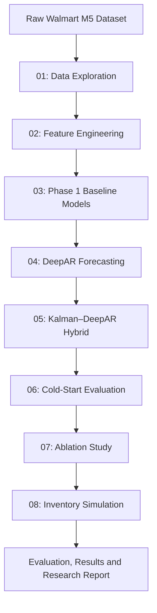

# Inventory Demand Forecasting — Walmart M5 Retail Analysis

[](https://www.python.org/)
[](https://scikit-learn.org/)
[](https://jupyter.org/)
[]()

> **Applied Machine Learning (AML) Team Project — Phase 1 & Phase 2**  
> An empirical study of intermittent retail demand forecasting using statistical state-space models, global machine learning, probabilistic deep learning, and causal hybrid forecasting on the Walmart M5 dataset.

---

## Table of Contents

- [Project Overview](#project-overview)
- [Research Objectives](#research-objectives)
- [Repository Architecture](#repository-architecture)
- [Dataset & Experimental Design](#dataset--experimental-design)
- [Forecasting Methodology & Pipeline](#forecasting-methodology--pipeline)
- [Models Evaluated](#models-evaluated)
- [Experimental Results](#experimental-results)
  - [Overall Model Comparison](#overall-model-comparison)
  - [Cold-Start Evaluation](#cold-start-evaluation)
  - [Ablation Study](#ablation-study)
  - [Probabilistic Calibration](#probabilistic-calibration)
  - [Inventory Simulation](#inventory-simulation)
- [Visualizations](#visualizations)
- [Setup & Installation](#setup--installation)
- [How to Run](#how-to-run)
- [Deliverables & Reports](#deliverables--reports)
- [Limitations & Future Work](#limitations--future-work)
- [References](#references)
- [License & Citation](#license--citation)

---

## Project Overview

In retail supply chains, inaccurate demand forecasts create two major operational problems: stockouts lead to lost sales, while excess inventory increases holding costs and potential spoilage.

Forecasting demand at the individual product-store level is particularly challenging because retail sales are frequently **intermittent, zero-inflated, seasonal, and influenced by changing prices, promotions, and calendar events**.

This project develops and evaluates an end-to-end forecasting framework using the **Walmart M5 Forecasting — Accuracy dataset**.

The work is organised into two phases:

**Phase 1 — Statistical and Machine Learning Baselines**

1. Explores intermittent demand patterns across products, stores, dates, and event schedules.
2. Develops a leak-free feature engineering pipeline using autoregressive lags, rolling statistics, calendar attributes, and SNAP indicators.
3. Establishes three forecasting benchmarks:
   - Seasonal Naive baseline.
   - Local-Level Kalman Filter.
   - Global Histogram-Based Gradient Boosting.

**Phase 2 — Probabilistic Deep Learning and Decision Support**

1. Implements a global DeepAR-style recurrent neural forecasting model with a Negative Binomial output distribution.
2. Develops a causal Kalman–DeepAR hybrid using dynamically estimated Kalman state features.
3. Evaluates limited-history transfer, zero-shot forecasting, and unseen store-item combinations.
4. Conducts controlled feature ablation experiments.
5. Evaluates probabilistic forecast calibration and uncertainty intervals.
6. Translates predictive distributions into an educational inventory replenishment policy comparison.

---

## Research Objectives

The primary objectives of this research are:

- Compare local statistical models, global machine learning, and probabilistic deep learning for intermittent retail demand.
- Evaluate forecasting methods using identical rolling-origin test windows.
- Prevent temporal leakage through past-only feature construction and causal state estimation.
- Model predictive uncertainty using q10, q50, and q90 quantile forecasts.
- Investigate generalisation to products with limited or unavailable historical observations.
- Measure the contribution of calendar, static, pricing, availability, and Kalman-derived features.
- Explore how probabilistic forecasts can support inventory replenishment decisions.
- Establish reproducible experiments through deterministic configurations, artifact manifests, and automated tests.

---

## Repository Architecture

```text
Inventory-demand-forecasting/
│
├── Datasets/
│   ├── raw/                         # Raw M5 CSV files (download separately)
│   └── processed/                    # Processed Phase 1 experiment data
│
├── Notebooks/
│   ├── 01_data_exploration.ipynb     # Exploratory data analysis
│   ├── 02_feature_engineering.ipynb  # Feature engineering and data preparation
│   ├── 03_model_development.ipynb    # Phase 1 forecasting benchmarks
│   ├── 04_deep_learning_forecasting.ipynb
│   ├── 05_kalman_deepar_hybrid.ipynb
│   ├── 06_cold_start_evaluation.ipynb
│   ├── 07_ablation_study.ipynb
│   └── 08_inventory_simulation.ipynb
│
├── configs/                          # Experiment configuration
│
├── models/
│   └── phase2/                       # Model manifests and metadata
│
├── src/
│   └── phase2/                       # Tested Phase 2 implementation
│
├── tests/
│   └── phase2/                       # Automated model and experiment tests
│
├── results/
│   ├── phase1_model_comparison.csv
│   ├── phase1_predictions.csv.gz
│   ├── phase1_window_results.csv
│   └── phase2/                       # Corrected Phase 2 experiment outputs
│
├── report/
│   ├── PHASE2_FINAL_RESEARCH_REPORT.pdf
│   └── figures/
│       └── phase2/                   # Phase 2 research visualizations
│
├── presentation/                     # Team presentation and assets
│
├── scripts/                          # Experiment and artifact generation utilities
│
├── .gitignore
├── CITATION.cff
├── LICENSE
├── README.md
└── requirements.txt
```

---

## Dataset & Experimental Design

The project uses the [Kaggle M5 Forecasting — Accuracy Competition](https://www.kaggle.com/c/m5-forecasting-accuracy/data) dataset.

The original dataset contains:

- **Daily Unit Sales (`sales_train_validation.csv`)**: Daily sales observations for 30,490 product-store series across 10 Walmart stores.
- **Calendar Data (`calendar.csv`)**: Dates, weekdays, months, events, and state-specific SNAP distribution indicators.
- **Pricing Data (`sell_prices.csv`)**: Historical weekly selling prices for individual products across stores.

### Phase 1 and Phase 2 evaluation sample

To support reproducible experimentation and manageable computational requirements, the primary forecasting experiments use:

- **Sample size:** 100 product-store series.
- **Store representation:** 10 series sampled from each of the 10 stores.
- **Sampling seed:** 42.
- **Forecast horizon:** 7 days.
- **Rolling evaluation origins:** 4.
- **Total final test forecasts:** 2,800 per model.

\[
100 \times 4 \times 7 = 2,800
\]

All headline models are compared using the same final evaluation observations.

### Data preparation and leakage prevention

The feature engineering pipeline includes:

- Autoregressive demand lags: `lag_1`, `lag_7`, and `lag_28`.
- Rolling demand statistics: 7-day and 28-day rolling means.
- Calendar features: weekday, month, weekend, and event indicators.
- SNAP distribution indicators.
- Product and store categorical identifiers.
- Price and availability-related features for Phase 2 experiments.

Rolling statistics are constructed using past observations only. Forecasting models use information available at each forecast origin, with recursive prediction where required.

**Availability limitation:** Availability is approximated using price presence and a store-closure flag. This is not verified inventory-on-hand data or a confirmed stockout indicator.

Raw M5 CSV files are intentionally excluded from version control. Download the competition data and place the extracted files in `Datasets/raw/`:

```text
Datasets/raw/
├── calendar.csv
├── sales_train_validation.csv
└── sell_prices.csv
```

---

## Forecasting Methodology & Pipeline

The research pipeline is organised into eight sequential notebooks.



### Phase 1 — Baseline Development

**1. Data Exploration (`01_data_exploration.ipynb`)**

- Examines demand sparsity and zero-sales distributions.
- Investigates weekly and monthly demand patterns.
- Analyses event schedules and store-level differences.
- Performs data quality and calendar continuity checks.

**2. Feature Engineering (`02_feature_engineering.ipynb`)**

- Converts the sampled wide sales matrix into a long-format forecasting dataset.
- Constructs lag and rolling-window features.
- Adds calendar, SNAP, and categorical identifiers.
- Defines reproducible rolling-origin evaluation windows.
- Prevents leakage through shifted rolling calculations.

**3. Model Development (`03_model_development.ipynb`)**

- Implements Seasonal Naive, Kalman Filter, and Gradient Boosting.
- Performs recursive seven-day forecasting.
- Evaluates all models on identical forecast observations.
- Generates prediction outputs and model comparison metrics.

### Phase 2 — Deep Learning and Decision Support

**4. Deep Learning Forecasting (`04_deep_learning_forecasting.ipynb`)**

- Implements a global autoregressive LSTM forecasting architecture.
- Uses static product/store representations through embeddings.
- Models count-valued demand with a Negative Binomial output distribution.
- Trains using autoregressive sequence construction and teacher forcing.
- Produces probabilistic forecast samples and q10, q50, and q90 predictions.

**5. Kalman–DeepAR Hybrid (`05_kalman_deepar_hybrid.ipynb`)**

- Extracts dynamic demand states using local-level Kalman filtering.
- Uses estimated level, variance, and innovation as neural model inputs.
- Applies strictly past-only scaling to prevent temporal leakage.
- Evaluates whether causal state information improves global neural forecasting.

The hybrid is a **feature-level integration**, not an average of two final model predictions.

**6. Cold-Start Evaluation (`06_cold_start_evaluation.ipynb`)**

- Evaluates forecasting performance with limited historical context.
- Investigates transfer to held-out item IDs.
- Measures zero-shot performance.
- Examines unseen store-item combinations.
- Compares forecasting accuracy across different history lengths.

**7. Ablation Study (`07_ablation_study.ipynb`)**

- Evaluates the contribution of target history.
- Investigates calendar and static categorical features.
- Examines the impact of Kalman-derived inputs.
- Compares controlled feature configurations using probabilistic metrics.

**8. Inventory Simulation (`08_inventory_simulation.ipynb`)**

- Converts predictive distributions into replenishment quantities.
- Implements a newsvendor-style quantile decision rule.
- Compares midpoint and cost-sensitive replenishment policies.
- Evaluates inventory cost and fill-rate trade-offs.

---

## Models Evaluated

| Model | Approach | Role |
|---|---|---|
| Seasonal Naive | Statistical baseline | Weekly seasonal persistence |
| Local-Level Kalman Filter | State-space model | Adaptive local demand estimation and uncertainty |
| Gradient Boosting | Global machine learning | Nonlinear lag and calendar feature modelling |
| DeepAR-style LSTM | Probabilistic deep learning | Global autoregressive demand distribution |
| Kalman–DeepAR Hybrid | Causal hybrid model | Kalman state features integrated into neural forecasting |

### 1. Seasonal Naive

Uses weekly periodic persistence to forecast future demand from the corresponding weekday in the previous week.

### 2. Local-Level Kalman Filter

Models demand using a local-level state-space formulation. The estimated latent demand level is updated as observations become available, while state uncertainty is propagated to construct prediction intervals.

### 3. Global Histogram-Based Gradient Boosting

Uses `HistGradientBoostingRegressor` trained across the sampled product-store series.

It captures nonlinear relationships between lagged demand, rolling statistics, calendar indicators, and categorical product/store information.

### 4. DeepAR-style LSTM

Uses a shared recurrent neural network to learn demand patterns across multiple product-store series.

A Negative Binomial output distribution models nonnegative count-valued demand and supports probabilistic forecasting.

### 5. Causal Kalman–DeepAR Hybrid

Extends the DeepAR architecture with causal Kalman-derived dynamic features, including estimated demand level, uncertainty, and innovation.

The objective is to investigate whether local state information improves global neural forecasting.

---

## Experimental Results

All headline models use the same 2,800 final test observations.

### Overall Model Comparison

| Model | MAE | RMSE | WAPE | Mean Pinball Loss | 80% Interval Coverage |
|---|---:|---:|---:|---:|---:|
| Seasonal Naive | 1.2096 | 2.7084 | 79.30% | — | — |
| Phase 1 Kalman | 1.0595 | 2.1752 | 69.46% | 0.3413 | 87.57% |
| Gradient Boosting | 1.0224 | **2.0397** | 67.03% | — | — |
| **DeepAR v2** | **0.9221** | 2.1194 | **60.45%** | **0.3113** | 93.89% |
| Causal Hybrid v2 | 0.9559 | 2.2728 | 62.67% | 0.3161 | 93.25% |

### Key Findings & Trade-offs

1. **DeepAR achieves the strongest MAE and WAPE performance.**
   - MAE: 0.9221.
   - WAPE: 60.45%.
   - Mean pinball loss: 0.3113.

2. **Gradient Boosting achieves the lowest RMSE.**
   - RMSE: 2.0397.
   - It remains a strong global machine learning baseline.

3. **The causal hybrid does not outperform standalone DeepAR.**
   - Hybrid MAE: 0.9559.
   - DeepAR MAE: 0.9221.
   - Adding Kalman features does not automatically improve predictive accuracy.

4. **Probabilistic intervals are conservative.**
   - DeepAR coverage: 93.89%.
   - Hybrid coverage: 93.25%.
   - Both exceed the nominal 80% central interval coverage, indicating a need for further calibration.

### Cold-Start Evaluation

The cold-start experiments investigate how forecasting performance changes when historical observations are restricted.

| Observed History | MAE | WAPE |
|---|---:|---:|
| 7 days | 1.1673 | 49.36% |
| 14 days | 1.1118 | 47.02% |
| 28 days | 1.1278 | 47.69% |
| 56 days | 1.1720 | 49.56% |
| Zero-shot | 2.3938 | 101.23% |

The held-out item evaluation contains 19 item IDs. Zero-shot forecasting has substantially higher error than limited-history transfer.

The new store-item combination cohort contains only three series, so its results are exploratory and insufficient for broad generalisation claims.

### Ablation Study

The ablation experiments investigate the contribution of different feature groups to probabilistic forecasting.

| Experiment | Mean Pinball Loss |
|---|---:|
| Complete DeepAR with price and availability | **0.3113** |
| Target-only DeepAR | 0.3184 |
| Calendar-only DeepAR | 0.3226 |
| Kalman feature addition | 0.3278 |
| Calendar and static embeddings | 0.3671 |
| Complete causal hybrid | 0.3161 |

The complete DeepAR configuration achieves the lowest reported pinball loss among these configurations. The results indicate that feature additions do not necessarily improve forecasting performance.

### Probabilistic Calibration

The nominal central prediction interval is q10–q90, corresponding to an 80% interval.

| Model | Empirical Coverage | Below q10 | Above q90 |
|---|---:|---:|---:|
| DeepAR v2 | 93.89% | 0.75% | 5.36% |
| Causal Hybrid v2 | 93.25% | 1.07% | 5.68% |

Both models demonstrate conservative interval coverage relative to the nominal 80% target. Further calibration should be performed using validation data before operational deployment.

### Inventory Simulation

The inventory experiment evaluates a simplified one-period replenishment decision using model forecasts.

| Policy | Total Cost | Fill Rate |
|---|---:|---:|
| DeepAR midpoint policy | 6,313 | 82.07% |
| Interpolated newsvendor policy | 7,025 | 89.18% |

The newsvendor policy achieves a higher fill rate under the assumed holding-to-stockout cost ratio of 1:4, with a corresponding increase in total simulated cost.

These results illustrate the trade-off between service level and inventory cost. They are educational simulation results rather than a full operational inventory optimisation.

---

## Visualizations

Research figures generated by the project are stored in `report/figures/phase2/`.

| Visualization | Description |
|---|---|
| Model MAE Comparison | Compares point forecasting performance across the five models |
| Cold-Start MAE | Compares performance across different historical context lengths |
| Coverage by Horizon | Examines probabilistic interval coverage |
| Interval Width by Horizon | Shows forecast uncertainty across horizons |
| Calibration Tail Miss Rates | Compares lower and upper interval misses |
| Ablation Pinball Loss | Compares feature configuration performance |
| Inventory Cost Comparison | Visualizes replenishment policy trade-offs |

Phase 1 exploratory figures and benchmark results are retained alongside the Phase 2 outputs.

---

## Setup & Installation

### Prerequisites

- Python 3.12 recommended.
- Git.
- Jupyter Notebook or JupyterLab.
- Access to the Walmart M5 dataset.

### 1. Clone the Repository

```bash
git clone https://github.com/tejuuu-7774/Inventory-demand-forecasting.git
cd Inventory-demand-forecasting
```

### 2. Create and Activate a Virtual Environment

**macOS / Linux**

```bash
python3.12 -m venv .venv
source .venv/bin/activate
```

**Windows — Command Prompt**

```bash
py -3.12 -m venv .venv
.venv\Scripts\activate.bat
```

**Windows — PowerShell**

```powershell
py -3.12 -m venv .venv
.venv\Scripts\Activate.ps1
```

### 3. Install Dependencies

The project uses one consolidated dependency file for both phases.

```bash
python -m pip install --upgrade pip
python -m pip install -r requirements.txt
```

### 4. Verify the Environment

```bash
python --version
python -m pip check
```

---

## How to Run

### Step 1: Download the M5 Dataset

Download the three required CSV files from the [Kaggle M5 Forecasting — Accuracy Competition](https://www.kaggle.com/c/m5-forecasting-accuracy/data).

Place the extracted files inside:

```text
Datasets/raw/
├── calendar.csv
├── sales_train_validation.csv
└── sell_prices.csv
```

### Step 2: Launch Jupyter

```bash
jupyter lab
```

Alternatively:

```bash
jupyter notebook
```

### Step 3: Execute Notebooks in Numerical Order

1. `01_data_exploration.ipynb` — Exploratory data analysis.
2. `02_feature_engineering.ipynb` — Data preparation and feature construction.
3. `03_model_development.ipynb` — Phase 1 model training and evaluation.
4. `04_deep_learning_forecasting.ipynb` — DeepAR model training and probabilistic forecasting.
5. `05_kalman_deepar_hybrid.ipynb` — Causal hybrid forecasting.
6. `06_cold_start_evaluation.ipynb` — Limited-history and zero-shot evaluation.
7. `07_ablation_study.ipynb` — Controlled feature comparisons.
8. `08_inventory_simulation.ipynb` — Inventory policy evaluation.

Run notebooks in order because later experiments depend on earlier data preparation and trained model artifacts.

### Step 4: Run Automated Tests

From the repository root:

```bash
python -m pytest tests/phase2 -q
```

The Phase 2 test suite covers data preparation, model behaviour, temporal leakage prevention, evaluation, artifact validation, cold-start experiments, statistical analysis, and inventory calculations.

---

## Deliverables & Reports

- **Final Phase 2 Research Report:** [`report/PHASE2_FINAL_RESEARCH_REPORT.pdf`](report/PHASE2_FINAL_RESEARCH_REPORT.pdf)
- **Phase 2 Research Figures:** [`report/figures/phase2/`](report/figures/phase2/)
- **Phase 1 Benchmark Results:** [`results/`](results/)
- **Corrected Phase 2 Experiment Results:** [`results/phase2/`](results/phase2/)
- **Phase 2 Model Manifests:** [`models/phase2/`](models/phase2/)
- **Experiment Configuration:** [`configs/`](configs/)
- **Automated Tests:** [`tests/phase2/`](tests/phase2/)

---

## Limitations & Future Work

Although the experiments demonstrate the potential of global probabilistic forecasting for intermittent retail demand, several limitations remain:

1. **Sample Size:** The primary benchmark uses 100 of the 30,490 M5 product-store series. Results should not be generalised to the full hierarchy without additional experiments.

2. **Availability Proxy:** Price presence and store-closure indicators do not provide verified inventory-on-hand or confirmed stockout information.

3. **Probabilistic Calibration:** DeepAR and the hybrid produce conservative prediction intervals that require further calibration.

4. **Cold-Start Generalisation:** The held-out item cohort is limited, and the new-combination experiment contains only three series.

5. **Inventory Simulation:** The current simulation is one-period and omits lead times, multi-period inventory carryover, storage capacity, and operational replenishment constraints.

6. **Hierarchical Evaluation:** Full M5 hierarchical WRMSSE evaluation across all 30,490 series remains future work.

7. **Additional Forecasting Baselines:** Croston's method, SBA, Temporal Fusion Transformers, and other intermittent-demand-specific approaches could provide useful comparisons.

8. **Operational Deployment:** Future work should incorporate real inventory levels, promotion schedules, replenishment lead times, and validation-based uncertainty calibration.

---

## References

1. Makridakis, S., Spiliotis, E., and Assimakopoulos, V. (2022). "M5 accuracy competition: Results, findings, and conclusions." *International Journal of Forecasting*.  
   [https://doi.org/10.1016/j.ijforecast.2021.11.013](https://doi.org/10.1016/j.ijforecast.2021.11.013)

2. Salinas, D., Flunkert, V., Gasthaus, J., and Januschowski, T. (2020). "DeepAR: Probabilistic forecasting with autoregressive recurrent networks." *International Journal of Forecasting*.  
   [https://doi.org/10.1016/j.ijforecast.2019.07.001](https://doi.org/10.1016/j.ijforecast.2019.07.001)

3. Kalman, R. E. (1960). "A New Approach to Linear Filtering and Prediction Problems." *Journal of Basic Engineering*.  
   [https://doi.org/10.1115/1.3662552](https://doi.org/10.1115/1.3662552)

4. Gneiting, T., and Raftery, A. E. (2007). "Strictly Proper Scoring Rules, Prediction, and Estimation." *Journal of the American Statistical Association*.  
   [https://doi.org/10.1198/016214506000001437](https://doi.org/10.1198/016214506000001437)

---

## License & Citation

This project is released under the license specified in [`LICENSE`](LICENSE).

Citation information is available in [`CITATION.cff`](CITATION.cff).